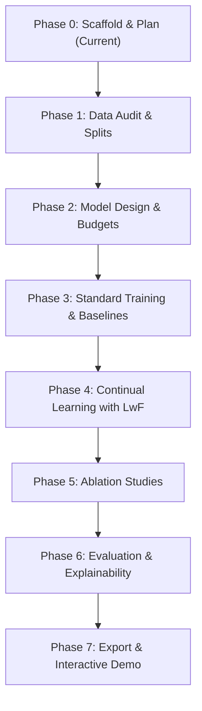

# Master Research Plan: Multi-Class Brain Tumor MRI Classification with LwF

## 1. Research Question & Hypothesis

### 1.1 Core Research Question
> **Can a lightweight custom convolutional neural network (<5M parameters) trained via Learning without Forgetting (LwF) retain diagnostic efficacy on previously learned brain tumor classes better than naive fine-tuning without storing historical patient MRI slices, and how does its retention and efficiency profile compare against Experience Replay (memory buffer) and Joint Training (upper bound oracle)?**

### 1.2 Scientific Hypotheses
1. **Catastrophic Forgetting Mitigation**: In a class-incremental scenario ($T_1 \to T_2 \to T_3$), naive fine-tuning will suffer catastrophic representation drift on early tumor classes, exhibiting forgetting $F > 30\%$. LwF distillation loss will constrain activation drift on shared feature representations, reducing forgetting significantly without storing patient exemplar images.
2. **Compact Model Regularization**: A lightweight custom CNN (<5M parameters) with Global Average Pooling (GAP) offers lower representational capacity than overparameterized networks (e.g., VGG16, ResNet18), which may induce stronger parameter competition during incremental steps, making distillation temperature $T$ tuning critical.
3. **Task Presentation Sensitivity**: Reversing class presentation order (Order A vs Order B) will demonstrate asymmetric representation retention depending on whether healthy control tissue (`notumor`) is introduced initial-stage or final-stage.

---

## 2. Research Objectives

1. **Scaffold & Reproducibility**: Establish a modular, configuration-driven, seed-deterministic framework across PyTorch, NumPy, and system runtimes.
2. **Rigorous Data Curation**: Audit the 7,023-image Nickparvar dataset for cross-source leakage, corruptions, and duplicate slices; isolate an untouched 1,311-image test set and a stratified 15% validation split (~857 images).
3. **Custom Lightweight Architecture**: Engineer a 4-block ConvNet strictly under 5,000,000 parameters with expandable classifier heads.
4. **Continual Learning Pipeline**: Implement Class-Incremental Learning (CIL) pipelines for:
   - Naive Fine-Tuning (lower bound)
   - Learning without Forgetting (LwF; primary method)
   - Experience Replay (fixed memory buffer)
   - Joint Training (non-continual upper bound oracle)
5. **Ablation & Sensitivity Analysis**: Quantify the impact of temperature $T \in \{1, 2, 4, 8\}$, distillation loss weight $\lambda \in \{0.5, 1.0, 2.0, 5.0\}$, memory buffer capacity ($N \in \{50, 100, 200\}$), and task ordering.
6. **Clinical Explainability**: Characterize feature drift using Grad-CAM attention visualizations across tasks.
7. **Deployment & Export**: Export the optimal model to ONNX, benchmark CPU/GPU latency, and deploy an interactive Gradio diagnostic demonstration.

---

## 3. Project Scope

### 3.1 In-Scope
- 4-class brain tumor classification: `glioma`, `meningioma`, `pituitary`, `notumor`.
- Class-incremental learning across 3 sequential tasks ($2 \to 1 \to 1$ class increments).
- Two distinct task orders (Order A and Order B) evaluated over 3 fixed seeds (`42`, `123`, `2024`).
- Strict model parameter budget (<5M parameters) for the custom CNN.
- Comparative baselines: Pretrained ResNet18 and VGG16.
- Full continual learning metrics: Average Incremental Accuracy, Forgetting, Backward Transfer, alongside standard classification metrics (Macro F1, Precision, Recall, Accuracy).
- Computational efficiency profiling: FLOPs, parameter count, disk footprint, and inference latency.
- Grad-CAM visual attention interpretability.
- Standalone ONNX runtime export and local Gradio demonstration.

### 3.2 Out-of-Scope
- Raw DICOM/NIfTI 3D volumetric MRI segmentation (input is strictly 2D axial/coronal/sagittal slices).
- Brain extraction using heavy deep-learning ensembles (e.g., HD-BET); standard OpenCV contour-based skull cropping is used.
- Domain-incremental or task-incremental setups requiring task IDs at test time (this work is strictly **Class-Incremental Learning** with a unified shared head).
- Multi-modal imaging (PET-MRI, CT fusion).

---

## 4. Dataset Specification

- **Dataset**: Masoud Nickparvar Brain Tumor MRI Dataset.
- **Total Images**: 7,023 2D MRI slices.
- **Classes**: 4 mutually exclusive categories:
  - `glioma`: ~1,621 images
  - `meningioma`: ~1,645 images
  - `pituitary`: ~1,757 images
  - `notumor`: ~2,000 images
- **Official Split**:
  - Official Train: 5,712 images
  - Official Test: 1,311 images (**held out strictly for final evaluation; never touched during training or tuning**)
- **Validation Split**: Stratified 15% carved from the official train set (~857 validation images, ~4,855 active training images).
- **Format**: JPG/PNG format, standardized to RGB $224 \times 224$ pixels.

---

## 5. Incremental Task Sequences

Experiments evaluate two distinct task sequences to examine order sensitivity and representation bias:

### 5.1 Order A (Pathology-First Sequence)
- **Task 1 ($T_1$)**: `{glioma, meningioma}` (Initial 2-class classifier)
- **Task 2 ($T_2$)**: `{pituitary}` (Expands classifier to 3 classes; evaluates retention of $T_1$)
- **Task 3 ($T_3$)**: `{notumor}` (Expands classifier to 4 classes; evaluates retention of $T_1$ and $T_2$)

### 5.2 Order B (Control-First Sequence)
- **Task 1 ($T_1$)**: `{notumor, pituitary}` (Initial 2-class classifier distinguishing healthy control from sellar lesion)
- **Task 2 ($T_2$)**: `{glioma}` (Expands classifier to 3 classes; evaluates retention of healthy/pituitary features)
- **Task 3 ($T_3$)**: `{meningioma}` (Expands classifier to 4 classes; evaluates complete retention)

---

## 6. Continual Learning Evaluation Metrics

Let $N$ be the total number of sequential tasks ($N=3$).  
Let $R_{i, j}$ denote the test classification accuracy evaluated on the test set of task $j$ after the model has completed training on task $i$ (where $1 \le j \le i \le N$).

### 6.1 Average Incremental Accuracy ($A_{\text{avg}}$)
Measures the overall performance trajectory of the model averaged across all incremental learning steps:
$$A_k = \frac{1}{k} \sum_{j=1}^{k} R_{k, j}$$
$$A_{\text{avg}} = \frac{1}{N} \sum_{k=1}^{N} A_k$$

### 6.2 Forgetting ($F$)
Quantifies the maximum performance degradation on past tasks observed after learning subsequent tasks:
$$f_j^k = \max_{l \in \{1, \dots, k-1\}} R_{l, j} - R_{k, j}, \quad \forall j < k$$
The average forgetting after completing all $N$ tasks is:
$$F = \frac{1}{N - 1} \sum_{j=1}^{N - 1} \left( \max_{l \in \{1, \dots, N-1\}} R_{l, j} - R_{N, j} \right)$$
*Lower is better ($F=0$ indicates zero forgetting).*

### 6.3 Backward Transfer ($\text{BWT}$)
Quantifies the net influence that learning subsequent tasks has on performance on past tasks:
$$\text{BWT} = \frac{1}{N - 1} \sum_{j=1}^{N - 1} (R_{N, j} - R_{j, j})$$
*Negative values indicate catastrophic forgetting; positive values indicate retroactive performance enhancement.*

### 6.4 Classification & Efficiency Metrics
- **Classification**: Top-1 Accuracy, Macro-Precision, Macro-Recall, Macro-F1, per-class Confusion Matrix.
- **Efficiency**: Total Parameter Count ($<5\times 10^6$), FLOPs (GFLOPs at $224 \times 224$), Checkpoint Size (MB), Inference Latency (mean $\pm$ std ms per image on CPU and GPU).

---

## 7. Experiment Matrix

Total configurations: **5 Methods $\times$ 2 Task Orders $\times$ 3 Seeds = 30 experimental runs**.

| Strategy ID | Method | Replay Buffer | Distillation Loss | Task Orders | Seeds | Total Runs |
|:---|:---|:---|:---|:---|:---|:---|
| `FT` | Naive Fine-Tuning | None | None | Order A, Order B | 42, 123, 2024 | 6 |
| `LwF` | Learning without Forgetting | None | $L_{\text{distill}} (T=2.0, \lambda=1.0)$ | Order A, Order B | 42, 123, 2024 | 6 |
| `ER` | Experience Replay | $M=200$ exemplars | None | Order A, Order B | 42, 123, 2024 | 6 |
| `LwF-ER` | LwF + Experience Replay (Ext) | $M=200$ exemplars | $L_{\text{distill}} (T=2.0, \lambda=1.0)$ | Order A, Order B | 42, 123, 2024 | 6 |
| `Joint` | Joint Training (Upper Bound) | Full Dataset | N/A (single non-continual stage) | Standard (All 4 classes) | 42, 123, 2024 | 3 |
| `Baselines` | ResNet18 & VGG16 Joint | Full Dataset | N/A | Standard | 42 | 2 |

---

## 8. Identified Risks & Mitigation Protocols

1. **Class-Incremental LwF Inherent Weakness**:
   - *Risk*: Pure LwF lacks exemplars of old classes, potentially leading to bias favoring newly introduced classes in the unconstrained output head.
   - *Mitigation*: Implement weight-clipping / cosine-normalization on output logits, temperature tuning via Optuna, and contrast with the hybrid `LwF-ER` ablation.
2. **Dataset Cross-Source Leakage**:
   - *Risk*: The Nickparvar dataset aggregates three open datasets (Figshare, SARTAJ, Br35H), which may contain near-duplicate patient slices across train and test partitions.
   - *Mitigation*: Run automated perceptual hashing (`pHash`) and structural similarity (`SSIM`) scans during Phase 1 Data Audit; flag and quarantine leaking pairs.
3. **Hard Model Budget (<5M Parameters)**:
   - *Risk*: Architectural bloat could exceed the 5M parameter threshold.
   - *Mitigation*: Strict architectural constraint utilizing Global Average Pooling (GAP) instead of heavy dense layers; verified via automated unit test assertions.
4. **Class Imbalance**:
   - *Risk*: Variations in per-class sample counts (e.g., glioma vs notumor) may distort class-incremental updates.
   - *Mitigation*: Employ stratified sampling across all splits and monitor Macro-F1 alongside Accuracy.

---

## 9. Phase-by-Phase Milestone Roadmap

- [x] **Phase 0: Environment Setup, Scaffolding, and Research Freeze**
  - [x] Repo directory hierarchy, `.gitkeep` files, package `__init__.py` modules.
  - [x] Virtual environment, pinned `requirements.txt`, PyTorch CUDA check.
  - [x] Base YAML configuration system and schema documentation.
  - [x] Seed-setting determinism utilities and unit tests.
  - [x] Core planning documents: `docs/PLAN.md`, `docs/DECISIONS.md`, `docs/METRICS.md`.
- [ ] **Phase 1: Data Engineering & Auditing**
  - [ ] Place dataset in `data/raw/` and verify counts.
  - [ ] Audit image resolutions, aspect ratios, corrupted files, and near-duplicates (`pHash`).
  - [ ] Implement OpenCV extreme contour cropping and skull-stripping.
  - [ ] Generate deterministic stratified train/val splits and incremental task manifests.
- [ ] **Phase 2: Lightweight Model Architecture Design**
  - [ ] Implement 4-block custom CNN with GAP and expandable classifier head.
  - [ ] Verify parameter budget is strictly under 5,000,000.
  - [ ] Implement ResNet18 and VGG16 baseline wrappers.
  - [ ] Unit test forward pass tensor dimensions and head expansion mechanics.
- [ ] **Phase 3: Standard Training & Baselines**
  - [ ] Implement core `Trainer` with early stopping, mixed precision, and metric logging.
  - [ ] Train Joint Training upper bound oracle (Custom CNN on all 4 classes).
  - [ ] Train ResNet18 and VGG16 joint baselines for comparative benchmarking.
  - [ ] Hyperparameter optimization study via Optuna.
- [ ] **Phase 4: Class-Incremental Learning & LwF Implementation**
  - [ ] Implement Naive Fine-Tuning sequential runner.
  - [ ] Implement Learning without Forgetting (teacher model freezing + distillation loss).
  - [ ] Implement Experience Replay buffer manager and sampler.
  - [ ] Run full experiment matrix across Order A, Order B, and 3 seeds.
- [ ] **Phase 5: Ablations & Sensitivity Analysis**
  - [ ] Distillation temperature ablation ($T \in \{1, 2, 4, 8\}$).
  - [ ] Distillation weight ablation ($\lambda \in \{0.5, 1.0, 2.0, 5.0\}$).
  - [ ] Memory buffer capacity ablation ($M \in \{50, 100, 200\}$).
  - [ ] Task ordering sensitivity comparison (Order A vs Order B).
- [ ] **Phase 6: In-Depth Evaluation & Explainability**
  - [ ] Compute $A_{\text{avg}}$, Forgetting ($F$), and $\text{BWT}$ across all runs.
  - [ ] Generate publication-quality comparison tables (mean $\pm$ std).
  - [ ] Generate confusion matrices and accuracy degradation curves.
  - [ ] Generate Grad-CAM attention maps to visualize representation drift.
- [ ] **Phase 7: Deployment, Packaging, and Final Documentation**
  - [ ] Export best checkpoints to optimized ONNX format.
  - [ ] Profile CPU and GPU inference latency.
  - [ ] Build and launch Gradio interactive web application with sample MRI slice viewer.
  - [ ] Compile final scientific report draft in `docs/report/`.
