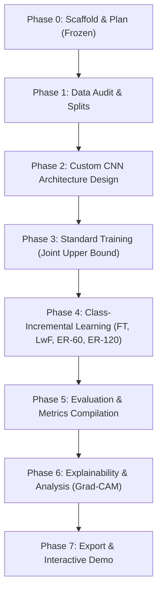

# Master Research Plan: Multi-Class Brain Tumor MRI Classification with LwF

## 1. Research Question & Hypothesis

### 1.1 Core Research Question
> **Can a lightweight custom CNN (<5M params) retain old tumor classes under class-incremental learning with LwF, and how does it compare with naive fine-tuning, tiny-buffer experience replay (60 and 120 images), and joint training?**

### 1.2 Scientific Hypotheses
1. **Catastrophic Forgetting Mitigation**: In a class-incremental scenario ($T_1 \to T_2 \to T_3$), naive fine-tuning will suffer catastrophic representation drift on early tumor classes. LwF distillation loss will constrain activation drift on shared feature representations, reducing forgetting significantly without storing patient exemplar images ($M=0$).
2. **Compact Model Regularization**: A lightweight custom CNN (<5M parameters, target roughly 1M to 3M) with Global Average Pooling (GAP) offers a compact parameter footprint where shared convolutional filters must accommodate expanding class representations. Distillation loss from the frozen previous-task model will regularize shared weights and prevent severe catastrophic forgetting.
3. **Replay Efficiency & Memory Trade-off**: Tiny exemplar buffers (fixed at 60 and 120 images total across all old classes, corresponding to 15–30 images/class after all classes are learned) will establish an empirical retention benchmark, quantifying the exact performance gain achieved by storing minimal patient data versus the zero-storage privacy-preserving LwF approach.
4. **Task Presentation Sensitivity**: Reversing class presentation order (Order A vs Order B) will reveal representation retention robustness when healthy control tissue (`notumor`) is introduced initial-stage versus final-stage.

---

## 2. Research Objectives

1. **Scaffold & Reproducibility**: Maintain a modular, configuration-driven, seed-deterministic framework across PyTorch, NumPy, and system runtimes evaluated across 2 fixed seeds (`42`, `123`).
2. **Rigorous Data Curation**: Audit the 7,023-image Nickparvar dataset for cross-source leakage, corruptions, and duplicate slices; isolate an untouched 1,311-image test set and a stratified 15% validation split (~857 images).
3. **Custom Lightweight Architecture**: Engineer a single custom 4-block ConvNet strictly under 5,000,000 parameters (target roughly 1M to 3M) with BatchNorm, ReLU, MaxPool, Global Average Pooling (GAP), and an expandable classifier head.
4. **Continual Learning Pipeline**: Implement and evaluate 4 incremental learning methods plus Joint training on the custom CNN:
   - Naive Fine-Tuning (lower bound)
   - Learning without Forgetting (LwF; main method, $M=0$)
   - Experience Replay with 60 images ($M=60$, class-balanced random selection)
   - Experience Replay with 120 images ($M=120$, class-balanced random selection)
   - Joint Training (upper bound oracle, all 4 classes at once)
5. **Trade-Off & Sensitivity Analysis**: Evaluate the trade-off between retention and memory cost ($M$), distillation temperature ($T$), and task presentation sequences (Order A vs Order B). Optuna hyperparameter tuning is optional.
6. **Clinical Explainability**: Characterize feature drift using Grad-CAM attention visualizations across incremental tasks.
7. **Deployment & Export**: Export the optimal model to ONNX, benchmark CPU/GPU latency, and deploy an interactive Gradio diagnostic demonstration.

---

## 3. Project Scope

### 3.1 In-Scope
- **Diagnostic Classes**: 4 mutually exclusive categories: `glioma`, `meningioma`, `pituitary`, `notumor`.
- **Continual Learning Paradigm**: Class-Incremental Learning (CIL) across 3 sequential tasks ($2 \to 1 \to 1$ class increments) with a unified, shared classification head.
- **Model**: **Single model architecture**: Custom CNN built from scratch (<5M params, target roughly 1M to 3M; 4 conv blocks with BatchNorm, ReLU, MaxPool; Global Average Pooling and an expandable classification head).
- **Methods**: Comparison is strictly between continual learning methods on the custom CNN: Naive Fine-Tuning, LwF, Experience Replay ($M=60$), Experience Replay ($M=120$), and Joint Training (upper bound).
- **Task Orders**: Order A and Order B.
- **Seeds**: 2 seeds (`42`, `123`).
- **Metrics**: Accuracy, Macro Precision, Recall, Macro-F1, Average Incremental Accuracy ($A_{\text{avg}}$), Forgetting ($F$), Backward Transfer ($\text{BWT}$), Parameter Count, FLOPs, Latency, and Memory Cost ($M$ stored patient images).
- **Interpretability & Export**: Grad-CAM attention drift mapping, ONNX export, and local Gradio demonstration.

### 3.2 Out-of-Scope
- ResNet18, VGG16, or any other comparison model architecture.
- Model-to-model comparisons (all comparisons are between continual learning methods on the custom CNN).
- Hybrid LwF + Replay or additional baseline families.
- 3D volumetric MRI segmentation (input is strictly 2D axial/coronal/sagittal slices).
- Task-incremental setups requiring task IDs during test inference.
- Multi-modal imaging (PET-MRI, CT fusion).

---

## 4. Dataset Specification & Audited Ground Truth

- **Dataset**: Brain Tumor MRI Dataset (7,200-image balanced distribution).
- **Total Images**: 7,200 2D MRI slices across 4 classes (**0 corrupted files**).
- **Classes**: Exactly 1,800 images per class (1:1:1:1 balanced distribution):
  - `glioma`: 1,400 train, 400 test (1,800 total) -> Global ID: 0
  - `meningioma`: 1,400 train, 400 test (1,800 total) -> Global ID: 1
  - `notumor`: 1,400 train, 400 test (1,800 total) -> Global ID: 2
  - `pituitary`: 1,400 train, 400 test (1,800 total) -> Global ID: 3
- **Official Split**:
  - Official Train: 5,600 images
  - Official Test: 1,600 images (**held out strictly for final evaluation; never touched during training or tuning**)
- **Validation Split**: Stratified 15% carved from train set per seed (840 validation images, 4,760 active training images), keeping near-duplicate clusters intact.
- **Format**: Standardized RGB $150 \times 150$ pixels (grayscale replicated to 3 channels).
- **Known Limitation**: 2,022 near-duplicate train/test pairs found in Phase 1 audit; test set absolute accuracy may be optimistic, but relative method ranking remains strictly fair.

---

## 4.1 Custom CNN Model Architecture & Width Variants

- **Architecture Family**: 4 Conv blocks (`Conv3x3 -> BatchNorm -> ReLU -> MaxPool2x2`), Global Average Pooling (GAP), `Dropout(0.4)`, and `ExpandableLinearHead`.
- **Width Variants Suite** (all stay strictly under 5M parameter cap with 4 classes):

| Variant | Channel Configuration | Total Params | FLOPs (M) | Model Size | CPU Latency | GPU Latency | Cap Check (<5M) |
|:---|:---:|:---:|:---:|:---:|:---:|:---:|:---:|
| **Small** | `[32, 64, 128, 128]` | **241,700** | 274.43 M | 0.92 MB | 2.36 ± 0.22 ms | 0.49 ± 0.03 ms | **PASS** |
| **Medium** | `[64, 128, 256, 288]` | **1,036,548** | 1077.56 M | 3.96 MB | 5.32 ± 0.59 ms | 0.60 ± 0.04 ms | **PASS** |
| **Large** | `[64, 160, 384, 544]` | **2,531,396** | 1929.55 M | 9.67 MB | 8.63 ± 0.39 ms | 1.25 ± 0.04 ms | **PASS** |

*Variant selection is deferred to Phase 3 based on standard joint training validation performance.*

---

## 5. Incremental Task Sequences

### 5.1 Order A (Pathology-First Sequence)
- **Task 1 ($T_1$)**: `{glioma, meningioma}` (Initial 2-class classifier)
- **Task 2 ($T_2$)**: `{pituitary}` (Expands classifier to 3 classes; evaluates retention of $T_1$)
- **Task 3 ($T_3$)**: `{notumor}` (Expands classifier to 4 classes; evaluates retention of $T_1$ and $T_2$)

### 5.2 Order B (Control-First Sequence)
- **Task 1 ($T_1$)**: `{notumor, pituitary}` (Initial 2-class classifier distinguishing healthy control from sellar lesion)
- **Task 2 ($T_2$)**: `{glioma}` (Expands classifier to 3 classes; evaluates retention of healthy/pituitary features)
- **Task 3 ($T_3$)**: `{meningioma}` (Expands classifier to 4 classes; evaluates complete retention)

---

## 6. Continual Learning Evaluation Metrics

Let $N = 3$ denote the total number of sequential tasks.  
Let $R_{i, j}$ denote test accuracy on task $j$ after completing training on task $i$ ($1 \le j \le i \le N$).

### 6.1 Average Incremental Accuracy ($A_{\text{avg}}$)
$$A_k = \frac{1}{k} \sum_{j=1}^{k} R_{k, j}, \quad A_{\text{avg}} = \frac{1}{N} \sum_{k=1}^{N} A_k$$

### 6.2 Forgetting ($F$)
$$F = \frac{1}{N - 1} \sum_{j=1}^{N - 1} \left( \max_{l \in \{1, \dots, N-1\}} R_{l, j} - R_{N, j} \right)$$

### 6.3 Backward Transfer ($\text{BWT}$)
$$\text{BWT} = \frac{1}{N - 1} \sum_{j=1}^{N - 1} (R_{N, j} - R_{j, j})$$

### 6.4 Replay Buffer Memory Cost & Efficiency Metrics
- **Memory Cost ($M$)**: Stored image count ($M=0$ for FT, LwF, Joint; $M=60$ or $M=120$ for Replay), reported directly next to Accuracy and Forgetting.
- **Classification**: Top-1 Accuracy, Macro-Precision, Macro-Recall, Macro-F1, per-class Confusion Matrix.
- **Efficiency (Custom CNN)**: Parameter count (<5M), FLOPs, Model Size (MB), Latency (ms/slice on CPU and GPU).

---

## 7. Experiment Matrix Summary

**Total: 18 experimental runs**
- **Incremental Runs**: 4 methods (`finetune`, `lwf`, `replay60`, `replay120`) $\times$ 2 orders (`Order A`, `Order B`) $\times$ 2 seeds (`42`, `123`) = **16 runs**.
- **Joint Upper Bound Runs**: 1 method (`joint`) $\times$ 2 seeds (`42`, `123`) = **2 runs**.

| Strategy | Architecture | Memory Buffer ($M$) | Distillation ($\lambda, T$) | Task Orders | Seeds | Runs |
|:---|:---|:---:|:---:|:---:|:---:|:---:|
| **Naive Fine-Tuning** | Custom CNN | 0 | None | Order A, Order B | 42, 123 | 4 |
| **Learning without Forgetting** | Custom CNN | 0 | $\lambda=1.0, T=2.0$ | Order A, Order B | 42, 123 | 4 |
| **Experience Replay (60)** | Custom CNN | 60 images | None | Order A, Order B | 42, 123 | 4 |
| **Experience Replay (120)** | Custom CNN | 120 images | None | Order A, Order B | 42, 123 | 4 |
| **Joint Training (Upper Bound)**| Custom CNN | 0 (all data) | N/A | Order-independent | 42, 123 | 2 |
| **Total** | | | | | | **18** |

---

## 8. Identified Risks & Mitigation Protocols

1. **Class-Incremental LwF Inherent Weakness**:
   - *Risk*: Pure LwF lacks exemplars of old classes, potentially leading to bias favoring newly introduced classes in the shared output head.
   - *Mitigation*: Benchmark LwF directly against tiny-buffer Experience Replay ($M=60$ and $M=120$ images) to precisely measure the empirical value of retaining 15–30 images per class vs. zero images.
2. **Dataset Cross-Source Leakage**:
   - *Risk*: The Nickparvar dataset aggregates three open datasets (Figshare, SARTAJ, Br35H), which may contain near-duplicate patient slices across train and test partitions.
   - *Mitigation*: Run automated perceptual hashing (`pHash`) and structural similarity (`SSIM`) scans during Phase 1 Data Audit; flag and quarantine leaking pairs.
3. **Hard Model Budget (<5M Parameters)**:
   - *Risk*: Architectural bloat could exceed the 5M parameter threshold.
   - *Mitigation*: Design the 4-block Custom CNN targeting roughly 1M to 3M parameters using Global Average Pooling (GAP) before the expandable head; verified via automated unit test assertions.
4. **Class Imbalance**:
   - *Risk*: Variations in per-class sample counts (e.g., glioma vs notumor) may distort class-incremental updates.
   - *Mitigation*: Employ stratified sampling across all splits and monitor Macro-F1 alongside Accuracy.

---

## 9. Phase-by-Phase Milestone Roadmap

- [x] **Phase 0: Environment Setup, Scaffolding, and Research Freeze**
  - [x] Repo directory hierarchy, `.gitkeep` files, package `__init__.py` modules.
  - [x] Virtual environment, pinned `requirements.txt`, PyTorch CUDA check.
  - [x] Base YAML configuration system and schema documentation.
  - [x] Seed-setting determinism utilities and unit tests (`[42, 123]`).
  - [x] Core planning documents updated: `docs/PLAN.md`, `docs/DECISIONS.md`, `docs/EXPERIMENT_MATRIX.md`, `docs/METRICS.md`.
- [x] **Phase 1: Data Engineering & Auditing**
  - [x] Place dataset in `data/raw/` and verify counts: 7,200 total images (5,600 Training, 1,600 Testing; exactly 1,400 train and 400 test per class across glioma, meningioma, notumor, pituitary).
  - [x] Audit image resolutions, aspect ratios, corrupted files (0 corrupted), exact duplicates (138 train groups, 15 test groups, 0 cross-split exact duplicates), and near-duplicates (`pHash` Hamming $\le 4$).
  - [x] Implement OpenCV extreme contour cropping with center crop fallback (measured fallback rate: 2.06%, 148 / 7,200 images).
  - [x] Standardize to $150 \times 150 \times 3$ (grayscale replicated to RGB) and cache in `data/processed/`.
  - [x] Generate deterministic stratified train/val splits (840 val, 4,760 train) and incremental task manifests for seeds `42` and `123`, keeping duplicate clusters intact.
  - [x] PyTorch `MRIDataset`, Albumentations augmentation pipelines, task builder for Orders A and B, Joint datasets, and class-balanced replay buffer sampler ($M=60, 120$).
  - [x] Unit test data suite (`tests/test_data.py`: 13 total project tests passing).
- [x] **Phase 2: Custom CNN Architecture Design**
  - [x] Implement 4-block Custom CNN family with GAP, `Dropout(0.4)`, and decoupled feature extraction.
  - [x] Implement 3 width variants (`small`: 0.24M, `medium`: 1.04M, `large`: 2.53M), all strictly under 5M limit with 4 classes.
  - [x] Implement `ExpandableLinearHead` copying weights bit-identically across task expansions ($2 \to 3 \to 4$ classes).
  - [x] Expose distillation access via `forward_old_logits()` and `get_old_logits()`.
  - [x] Implement profiling utilities (parameters, FLOPs via fvcore/thop, model size, CPU/GPU latency).
  - [x] Unit test model suite (`tests/test_models.py`: 24 total project tests passing, including GPU forward+backward pass).
- [x] **Phase 3: Standard Training (Joint Upper Bound) & Variant Selection (Updated Stage A)**
  - [x] Reusable `fit()` trainer supporting fixed-epoch cosine decay without early stopping and dual checkpoint saving (`best.pt` and `last.pt`).
  - [x] Re-ran 6 Joint Training runs (3 variants $\times$ 2 seeds `[42, 123]`) under fixed 30-epoch cosine annealing:
    - `small` (241.7k params): Mean Val Macro-F1 = **0.9189 ± 0.0100** | Mean Test Macro-F1 = 0.8514 ± 0.0063
    - `medium` (1.04M params): Mean Val Macro-F1 = **0.9313 ± 0.0093** | Mean Test Macro-F1 = 0.8831 ± 0.0057
    - `large` (2.53M params): Mean Val Macro-F1 = **0.9388 ± 0.0101** | Mean Test Macro-F1 = 0.8955 ± 0.0010
  - [x] Applied frozen selection rule: **`medium`** selected as the main variant (Occam's razor: smallest candidate within 1 percentage point of best score 0.9388; 0.9313 vs 0.9388 is 0.75 pp gap; 1.04M params under 5M limit).
  - [x] Computed diagnostic on augmented vs. non-augmented test slices: aug error rate = 7.28% vs non-aug = 11.65%.
  - [x] Determined per-task epoch budget: **`E = 30`** epochs via 3-epoch moving average analysis.
  - [x] Generated training curves and normalized confusion matrix in `results/figures/confusion_matrix_joint_medium.png`.
  - [x] Unit test training suite (`tests/test_training.py` and `tests/test_incremental.py`: 34 total project tests passing).
- [x] **Phase 4: Class-Incremental Learning Implementation**
  - [x] Implement Naive Fine-Tuning sequential runner with expanding classification head.
  - [x] Implement Learning without Forgetting (teacher snapshot + distillation loss with $T=2.0, \lambda=1.0$).
  - [x] Implement Experience Replay with fixed total buffers of 60 and 120 images (class-balanced random selection from train split only).
  - [x] Execute all 16 incremental runs (4 methods $\times$ 2 orders $\times$ 2 seeds) on the Custom CNN (Medium variant, 1.04M params) with $E=30$ fixed epochs.
  - [x] Validated continual learning sanity checks: Naive Fine-Tuning exhibits catastrophic forgetting ($F = 0.9688$), while Replay-120 mitigates forgetting ($F = 0.3696$) and achieves highest incremental accuracy ($A_{\text{avg}} = 0.8135$).
- [x] **Stage D: LwF Architectural Refinements, Order C & Diagnostic Benchmarking**
  - [x] Implemented Order C (2 tasks: T1={glioma, meningioma}, T2={pituitary, notumor}) with bit-identical shared Task 1 starting weights.
  - [x] Implemented restricted old-class accuracy and softmax probability mass diagnostics to isolate representation drift from output-head logit depression.
  - [x] Executed 12 screening runs on Seed 42 across 6 candidate LwF variants (V2 `lwfL`, V3 `lwfLF`, V4 `lwfLF_frz` with $\lambda \in \{1, 10\}$) on Orders A and C.
  - [x] Applied pre-registered frozen selection rule: `lwfLF_frz_l1` selected as `lwfPlus` with highest mean validation Macro-F1 ($0.2211$).
  - [x] Executed full Stage D evaluation: `lwfPlus` on Orders A, B, C $\times$ Seeds `[42, 123]` (6 runs) plus complete Order C comparison suite (`finetune`, `lwf_all`, `lwf_new`, `replay60`, `replay120`, 10 runs).
  - [x] Uncovered definitive empirical findings:
    - Orders A & B (single-class incremental steps): Severe task-recency bias collapses old-class representation to random chance ($0.3333$ restricted acc), allocating $98\%$ softmax mass to the newest class.
    - Order C (multi-class incremental steps): Standard LwF retains old-class feature boundaries ($85.6\%$ restricted accuracy), but CE over all seen classes drives old logits down ($0.4\%$ old softmax mass).
    - `lwf_new` (CE over new logits only + KD on old logits) eliminates logit depression without exemplars ($47.2\%$ old mass), achieving **$0.5904$ Macro-F1** and **$0.4681$ forgetting**, surpassing `replay60` ($0.5608$ F1, $0.6094$ F) with 0 stored images.
- [ ] **Phase 5: Evaluation & Metrics Compilation**
  - [x] Compute $A_{\text{avg}}$, Forgetting ($F$), $\text{BWT}$, and report Replay Memory Cost ($M$) alongside classification metrics.
  - [x] Profile Custom CNN efficiency: parameter count (1,036,548), FLOPs (1077.56 MFLOPs), model size (4.15 MB), latency.
  - [x] Generate publication-quality comparison tables (`results/tables/incremental_results.md` and `.csv`, mean $\pm$ std across seeds).
  - [ ] Generate confusion matrices and task accuracy trajectory curves across tasks.
- [ ] **Phase 6: Explainability & Analysis**
  - [ ] Generate Grad-CAM attention maps to visualize representation drift across incremental tasks.
- [ ] **Phase 7: Deployment, Packaging, and Final Documentation**
  - [ ] Export best Custom CNN checkpoint to optimized ONNX format.
  - [ ] Profile CPU and GPU inference latency.
  - [ ] Build and launch Gradio interactive web application with sample MRI slice viewer.
  - [ ] Compile final scientific report draft in `docs/report/`.
