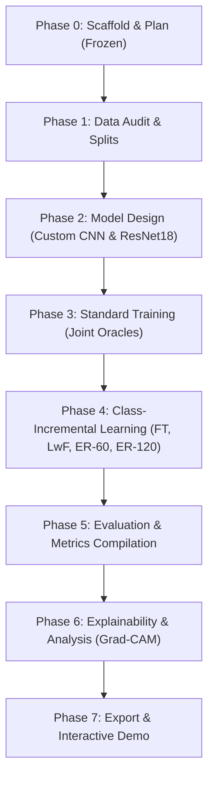

# Master Research Plan: Multi-Class Brain Tumor MRI Classification with LwF

## 1. Research Question & Hypothesis

### 1.1 Core Research Question
> **Can a lightweight custom CNN (<5M params) retain old tumor classes under class-incremental learning with LwF, compared with a pretrained ResNet18, and how does it compare with naive fine-tuning, tiny-buffer experience replay (60 and 120 images), and joint training?**

### 1.2 Scientific Hypotheses
1. **Catastrophic Forgetting Mitigation**: In a class-incremental scenario ($T_1 \to T_2 \to T_3$), naive fine-tuning will suffer catastrophic representation drift on early tumor classes. LwF distillation loss will constrain activation drift on shared feature representations, reducing forgetting significantly without storing patient exemplar images ($M=0$).
2. **Compact Scratch Model vs. Pretrained Overparameterized Model**: The custom lightweight CNN (<5M parameters, target 1M-3M) trained from scratch will exhibit distinct stability-plasticity dynamics compared to ImageNet-pretrained ResNet18 (~11.7M parameters). Pretrained features in ResNet18 may offer stronger feature generalizability, but LwF distillation will provide vital regularization for the compact custom CNN.
3. **Replay Efficiency**: Tiny exemplar buffers (60 and 120 images total, corresponding to 15–30 images/class after all classes are learned) will establish a measurable retention-vs-privacy baseline, demonstrating the degree of retention that can be achieved with minimal patient data storage compared to zero-storage LwF.
4. **Task Presentation Sensitivity**: Reversing class presentation order (Order A vs Order B) will test representation retention robustness when healthy control tissue (`notumor`) is introduced initial-stage versus final-stage.

---

## 2. Research Objectives

1. **Scaffold & Reproducibility**: Maintain a modular, configuration-driven, seed-deterministic framework across PyTorch, NumPy, and system runtimes evaluated across 2 fixed seeds (`42`, `123`).
2. **Rigorous Data Curation**: Audit the 7,023-image Nickparvar dataset for cross-source leakage, corruptions, and duplicate slices; isolate an untouched 1,311-image test set and a stratified 15% validation split (~857 images).
3. **Dual Model Architecture**: 
   - Engineer a 4-block Custom ConvNet strictly under 5,000,000 parameters (target roughly 1M to 3M) with Global Average Pooling (GAP) and expandable classifier head (Main Model).
   - Configure a pretrained ResNet18 with an expandable classifier head (Reference Model).
4. **Continual Learning Pipeline**: Implement and evaluate 4 incremental learning methods across BOTH models using identical training pipelines:
   - Naive Fine-Tuning (lower bound)
   - Learning without Forgetting (LwF; main method, $M=0$)
   - Experience Replay with 60 images ($M=60$, class-balanced random selection)
   - Experience Replay with 120 images ($M=120$, class-balanced random selection)
   - Joint Training (upper bound oracle, all 4 classes at once)
5. **Trade-Off & Sensitivity Analysis**: Compare retention vs. memory cost ($M$), distillation temperature ($T$), and task presentation sequences (Order A vs Order B). Optuna hyperparameter tuning is optional.
6. **Clinical Explainability**: Characterize feature drift using Grad-CAM attention visualizations across tasks.
7. **Deployment & Export**: Export the optimal model to ONNX, benchmark CPU/GPU latency, and deploy an interactive Gradio diagnostic demonstration.

---

## 3. Project Scope

### 3.1 In-Scope
- **Diagnostic Classes**: 4 mutually exclusive categories: `glioma`, `meningioma`, `pituitary`, `notumor`.
- **Continual Learning Paradigm**: Class-Incremental Learning (CIL) across 3 sequential tasks ($2 \to 1 \to 1$ class increments) with a unified, shared classification head.
- **Models**:
  1. **Custom CNN**: Scratch-trained, 4 conv blocks (32, 64, 128, 128), BatchNorm, ReLU, MaxPool, GAP, expandable head (<5M params, target 1M-3M). **Main model**.
  2. **ResNet18**: Pretrained on ImageNet-1k, expandable head. **Reference model**.
- **Methods**: Naive Fine-Tuning, LwF, Experience Replay ($M=60$), Experience Replay ($M=120$), and Joint Training (upper bound).
- **Task Orders**: Order A and Order B.
- **Seeds**: 2 seeds (`42`, `123`).
- **Metrics**: Accuracy, Macro Precision, Recall, Macro-F1, Average Incremental Accuracy ($A_{\text{avg}}$), Forgetting ($F$), Backward Transfer ($\text{BWT}$), Parameter Count, FLOPs, Latency, and Memory Cost ($M$ stored patient images).
- **Interpretability & Export**: Grad-CAM attention drift mapping, ONNX export, and local Gradio demonstration.

### 3.2 Out-of-Scope
- VGG16 or other heavy legacy architectures.
- Hybrid LwF + Replay or additional baseline families.
- 3D volumetric MRI segmentation (input is strictly 2D axial/coronal/sagittal slices).
- Task-incremental setups requiring task IDs during test inference.
- Multi-modal imaging (PET-MRI, CT fusion).

---

## 4. Dataset Specification

- **Dataset**: Masoud Nickparvar Brain Tumor MRI Dataset.
- **Total Images**: 7,023 2D MRI slices.
- **Classes**: 4 categories:
  - `glioma`: ~1,621 images
  - `meningioma`: ~1,645 images
  - `pituitary`: ~1,757 images
  - `notumor`: ~2,000 images
- **Official Split**:
  - Official Train: 5,712 images
  - Official Test: 1,311 images (**held out strictly for final evaluation; never touched during training or tuning**)
- **Validation Split**: Stratified 15% carved from the official train set (~857 validation images, ~4,855 active training images).
- **Format**: Standardized RGB $224 \times 224$ pixels.

---

## 5. Incremental Task Sequences

### 5.1 Order A (Pathology-First Sequence)
- **Task 1 ($T_1$)**: `{glioma, meningioma}` (Initial 2-class classifier)
- **Task 2 ($T_2$)**: `{pituitary}` (Expands classifier to 3 classes; evaluates retention of $T_1$)
- **Task 3 ($T_3$)**: `{notumor}` (Expands classifier to 4 classes; evaluates retention of $T_1$ and $T_2$)

### 5.2 Order B (Control-First Sequence)
- **Task 1 ($T_1$)**: `{notumor, pituitary}` (Initial 2-class classifier distinguishing healthy control from sellar lesion)
- **Task 2 ($T_2$)**: `{glioma}` (Expands classifier to 3 classes; evaluates retention of healthy/pituitary features)
- **Task 3 ($T_3$)**: `{meningioma}` (Expands classifier to 4 classes; evaluates complete retention)

---

## 6. Continual Learning Evaluation Metrics

Let $N = 3$ denote the total number of sequential tasks.  
Let $R_{i, j}$ denote test accuracy on task $j$ after completing training on task $i$ ($1 \le j \le i \le N$).

### 6.1 Average Incremental Accuracy ($A_{\text{avg}}$)
$$A_k = \frac{1}{k} \sum_{j=1}^{k} R_{k, j}, \quad A_{\text{avg}} = \frac{1}{N} \sum_{k=1}^{N} A_k$$

### 6.2 Forgetting ($F$)
$$F = \frac{1}{N - 1} \sum_{j=1}^{N - 1} \left( \max_{l \in \{1, \dots, N-1\}} R_{l, j} - R_{N, j} \right)$$

### 6.3 Backward Transfer ($\text{BWT}$)
$$\text{BWT} = \frac{1}{N - 1} \sum_{j=1}^{N - 1} (R_{N, j} - R_{j, j})$$

### 6.4 Replay Buffer Memory Cost & Efficiency Metrics
- **Memory Cost ($M$)**: Stored image count ($M=0$ for FT, LwF, Joint; $M=60$ or $M=120$ for Replay), reported directly next to Accuracy and Forgetting.
- **Classification**: Top-1 Accuracy, Macro-Precision, Macro-Recall, Macro-F1, per-class Confusion Matrix.
- **Efficiency**: Parameter count ($<5\text{M}$ for Custom CNN), FLOPs, Model Size (MB), Latency (ms/slice on CPU and GPU).

---

## 7. Experiment Matrix Summary

**Total: 36 experimental runs**
- **Incremental Runs**: 4 methods (`finetune`, `lwf`, `replay60`, `replay120`) $\times$ 2 models (`Custom CNN`, `ResNet18`) $\times$ 2 orders (`Order A`, `Order B`) $\times$ 2 seeds (`42`, `123`) = **32 runs**.
- **Joint Upper Bound Runs**: 1 method (`joint`) $\times$ 2 models (`Custom CNN`, `ResNet18`) $\times$ 2 seeds (`42`, `123`) = **4 runs**.

| Strategy | Models | Memory Buffer ($M$) | Distillation ($\lambda, T$) | Task Orders | Seeds | Runs |
|:---|:---|:---:|:---:|:---:|:---:|:---:|
| **Naive Fine-Tuning** | Custom CNN, ResNet18 | 0 | None | Order A, Order B | 42, 123 | 8 |
| **Learning without Forgetting** | Custom CNN, ResNet18 | 0 | $\lambda=1.0, T=2.0$ | Order A, Order B | 42, 123 | 8 |
| **Experience Replay (60)** | Custom CNN, ResNet18 | 60 images | None | Order A, Order B | 42, 123 | 8 |
| **Experience Replay (120)** | Custom CNN, ResNet18 | 120 images | None | Order A, Order B | 42, 123 | 8 |
| **Joint Training (Upper Bound)**| Custom CNN, ResNet18 | 0 (all data) | N/A | Order-independent | 42, 123 | 4 |
| **Total** | | | | | | **36** |

---

## 8. Identified Risks & Mitigation Protocols

1. **Class-Incremental LwF Inherent Weakness**:
   - *Risk*: Pure LwF lacks exemplars of old classes, potentially leading to bias favoring newly introduced classes in the shared output head.
   - *Mitigation*: Benchmark LwF directly against tiny-buffer Experience Replay ($M=60$ and $M=120$ images) to precisely measure the empirical value of retaining 15–30 images per class vs. zero images.
2. **Dataset Cross-Source Leakage**:
   - *Risk*: The Nickparvar dataset aggregates three open datasets (Figshare, SARTAJ, Br35H), which may contain near-duplicate patient slices across train and test partitions.
   - *Mitigation*: Run automated perceptual hashing (`pHash`) and structural similarity (`SSIM`) scans during Phase 1 Data Audit; flag and quarantine leaking pairs.
3. **Hard Model Budget (<5M Parameters)**:
   - *Risk*: Architectural bloat could exceed the 5M parameter threshold.
   - *Mitigation*: Design the 4-block Custom CNN targeting roughly 1M to 3M parameters using Global Average Pooling (GAP) before the expandable head; verified via automated unit test assertions.
4. **Class Imbalance**:
   - *Risk*: Variations in per-class sample counts (e.g., glioma vs notumor) may distort class-incremental updates.
   - *Mitigation*: Employ stratified sampling across all splits and monitor Macro-F1 alongside Accuracy.

---

## 9. Phase-by-Phase Milestone Roadmap

- [x] **Phase 0: Environment Setup, Scaffolding, and Research Freeze**
  - [x] Repo directory hierarchy, `.gitkeep` files, package `__init__.py` modules.
  - [x] Virtual environment, pinned `requirements.txt`, PyTorch CUDA check.
  - [x] Base YAML configuration system and schema documentation.
  - [x] Seed-setting determinism utilities and unit tests (`[42, 123]`).
  - [x] Core planning documents updated: `docs/PLAN.md`, `docs/DECISIONS.md`, `docs/EXPERIMENT_MATRIX.md`, `docs/METRICS.md`.
- [ ] **Phase 1: Data Engineering & Auditing**
  - [ ] Place dataset in `data/raw/` and verify counts.
  - [ ] Audit image resolutions, aspect ratios, corrupted files, and near-duplicates (`pHash`).
  - [ ] Implement OpenCV extreme contour cropping and skull-stripping.
  - [ ] Generate deterministic stratified train/val splits and incremental task manifests for seeds `42` and `123`.
- [ ] **Phase 2: Model Architectures (Custom CNN & ResNet18)**
  - [ ] Implement 4-block Custom CNN (target 1M to 3M, strictly <5M params) with GAP and expandable classifier head.
  - [ ] Implement ResNet18 reference model with expandable classifier head.
  - [ ] Unit test forward pass tensor dimensions and head expansion mechanics.
- [ ] **Phase 3: Standard Joint Training (Upper Bounds)**
  - [ ] Implement core `Trainer` with early stopping, mixed precision, and metric logging.
  - [ ] Train Joint Training upper bound oracles on all 4 classes for both Custom CNN and ResNet18 across seeds `42` and `123`.
  - [ ] (Optional) Run Optuna study for hyperparameter tuning.
- [ ] **Phase 4: Class-Incremental Learning Implementation**
  - [ ] Implement Naive Fine-Tuning sequential runner.
  - [ ] Implement Learning without Forgetting (teacher snapshot + distillation loss).
  - [ ] Implement Experience Replay with fixed total buffers of 60 and 120 images (class-balanced random selection).
  - [ ] Execute 32 incremental runs (4 methods $\times$ 2 models $\times$ 2 orders $\times$ 2 seeds).
- [ ] **Phase 5: Evaluation & Metrics Compilation**
  - [ ] Compute $A_{\text{avg}}$, Forgetting ($F$), $\text{BWT}$, and report Replay Memory Cost ($M$) alongside classification metrics.
  - [ ] Generate publication-quality comparison tables (mean $\pm$ std across seeds).
  - [ ] Generate confusion matrices and task accuracy trajectory curves.
- [ ] **Phase 6: Explainability & Analysis**
  - [ ] Generate Grad-CAM attention maps to visualize representation drift across tasks.
  - [ ] Perform comparative analysis between scratch-trained Custom CNN and pretrained ResNet18.
- [ ] **Phase 7: Deployment, Packaging, and Final Documentation**
  - [ ] Export best checkpoints to optimized ONNX format.
  - [ ] Profile CPU and GPU inference latency.
  - [ ] Build and launch Gradio interactive web application with sample MRI slice viewer.
  - [ ] Compile final scientific report draft in `docs/report/`.
